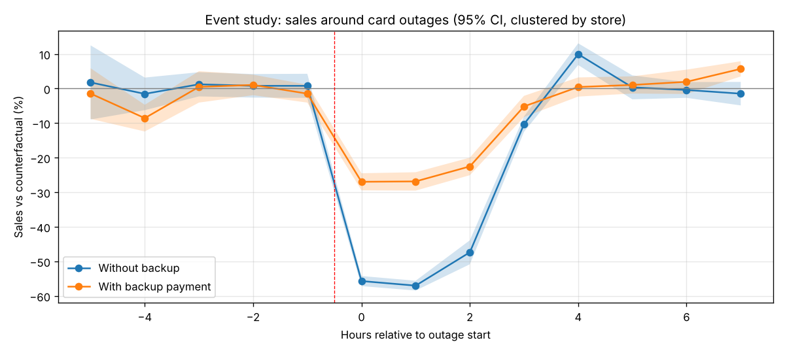
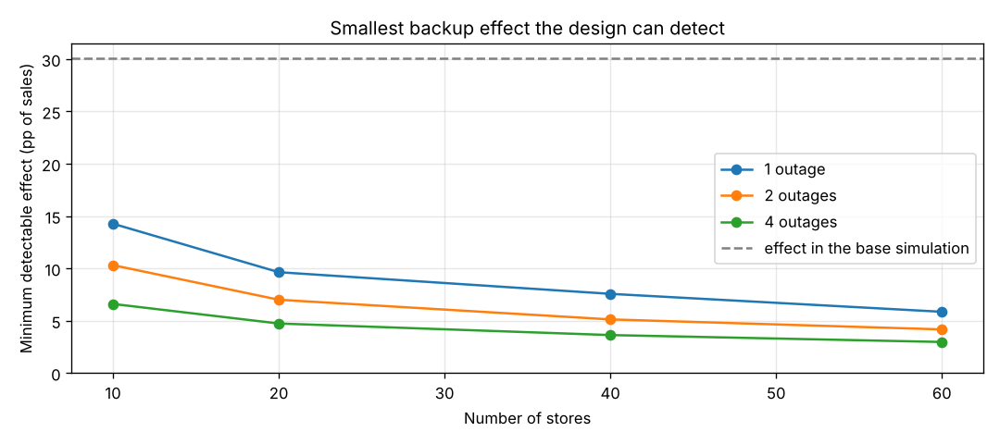

# What Is a Backup Payment Option Worth? An Event Study of Card Outages

**How much revenue do stores lose when card payments fail, and how much does a backup payment option (account-to-account / QR at the till) retain?**

This repository is the **method and data plan** for my master's thesis proposal on payment resilience. The design works **without access to company transaction data**: it combines public sources, a merchant survey and a calibrated simulation. The code shows the method recovers known effects, and that the pipeline from survey answers to results is ready.



## Why it matters
- Card outages are rare but costly, and Sweden has very little cash left as a fallback.
- The Riksbank agreed with the payment industry that offline card payments for essential goods should be possible from 1 July 2026.
- Mäder, Meyer, Nacht & Gatica-Perez (2026, SNB Working Paper 2026-12) found that consumers fell back on **cash** during a Swiss card outage. Can **digital** fallbacks play that role in low-cash Sweden?

## Design: three work packages
| Work package | Data | In this repository |
|---|---|---|
| **WP1** Public evidence | Riksbank statistics; public outage reports | [`templates/outage_catalogue_template.csv`](templates/) (empty template: rows only from cited sources) |
| **WP2** Merchant survey and interviews | Survey answers | [`survey/questionnaire.md`](survey/questionnaire.md), [`survey/analysis.py`](survey/analysis.py): descriptives, adoption logit, calibration |
| **WP3** Calibrated simulation and cost-benefit | Synthetic data built from WP1 + WP2 | [`config/assumptions.json`](config/assumptions.json), `simulate.py`, `analysis.py`, `power.py` |

Every assumption sits in `config/assumptions.json`, with a note on which source or survey question will replace it.

## Method
1. **Counterfactual sales** from a fixed-effects model estimated on normal hours: `log(sales) = store + day + weekday×hour + error`, estimated by alternating projections, as in Stata's `reghdfe`.
2. **Event study:** sales vs counterfactual by hour around each outage, with a pre-trend check and confidence intervals clustered by store.
3. **Difference-in-differences:** `residual = b0 + b1·outage + b2·backup + b3·(outage × backup) + b4·after + b5·(after × backup)`, with store-clustered standard errors. The hours right after an outage are modelled separately, so delayed purchases do not bias the estimate.
4. **Robustness:** a simulation where bigger stores are more likely to have a backup. A naive comparison is badly biased there, while DiD is not.
5. **Data requirements:** a Monte Carlo power study. How many stores and outages are needed to detect a given effect?
6. **Economics:** the value of a backup as insurance (share retained × sales per outage hour × outage hours per year × gross margin), with a break-even analysis.

## Results on simulated data
| | True value | Estimate (95% CI) |
|---|---|---|
| Sales change during an outage, no backup | −55.9% | −56.4% [−58.1, −54.8] |
| Extra share of sales kept with a backup | +30.1 pp | +30.0 pp [27.5, 32.5] |

**Data needed:** with 20 stores and 1 outage the design detects effects of about 10 pp or more; with 40 stores and 2 outages, about 5 pp.



**Economics:** with ~11 outage hours a year and a 30% gross margin, a backup is worth about 5,300 SEK per store per year, close to the assumed cost. The answer depends mostly on outage frequency, which is why the outage catalogue (WP1) matters.

## Project structure
```
card-outage-event-study/
├── outage_event_study.ipynb      # full analysis (start here)
├── config/assumptions.json       # every assumption + where its real value will come from
├── simulate.py                   # simulated store-hour sales with outages
├── analysis.py                   # counterfactual, event study, DiD, value of a backup
├── power.py                      # Monte Carlo: how much data is enough
├── survey/
│   ├── questionnaire.md          # 16-question merchant survey (draft)
│   └── analysis.py               # descriptives, adoption logit, calibration -> config
├── templates/                    # empty outage catalogue + column guide (WP1)
├── tests/                        # automated checks (pytest)
└── images/                       # charts used in this README
```

## How to run
```bash
pip install -r requirements.txt
jupyter notebook outage_event_study.ipynb
pytest -q                          # 6 automated checks, a few seconds
```

## References
- Mäder, A. R., Meyer, C., Nacht, Y. & Gatica-Perez, D. (2026). *Cash saves the day: How cash infrastructure enhances resilience during a card payment system outage.* SNB Working Paper 2026-12.
- Sveriges Riksbank (2025). *Offline card payments should be possible no later than 1 July 2026.*
- Angrist, J. & Pischke, J.-S. (2009). *Mostly Harmless Econometrics.* Princeton University Press.

## Tools
Python (pandas, NumPy, statsmodels, Matplotlib), pytest, Jupyter

*All data is simulated or synthetic.*

## License
MIT. See [LICENSE](LICENSE).
